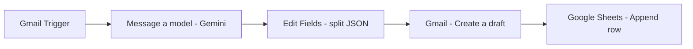

# AI Email Assistant (n8n + Gemini)

An automation built in **n8n Cloud** that reads incoming Gmail messages, classifies them with AI, writes a short summary, drafts a polite reply, and logs everything to Google Sheets.

> Replies are saved as **drafts only**. Nothing is sent automatically.

## Demo

- Demo video: `ADD LINK HERE`
- Screenshots are in the [`/screenshots`](./screenshots) folder.


## What it does

1. Watches a Gmail inbox for new emails.
2. Sends the sender, subject, and body to Google Gemini.
3. Gets back a category, a 2-sentence summary, and a draft reply.
4. Saves the reply as a Gmail draft.
5. Appends a row to a Google Sheet for tracking.

**Categories:** Inquiry, Complaint, Spam, Other

## Workflow



| Node | Purpose |
|---|---|
| Gmail Trigger | Polls the inbox for new emails |
| Message a model (Gemini 2.5 Flash) | Classifies, summarizes, and drafts a reply, returned as JSON |
| Edit Fields | Splits the JSON into `category`, `summary`, and `reply` fields |
| Create a draft (Gmail) | Saves the AI reply as a draft |
| Append row (Google Sheets) | Logs date, sender, subject, category, and summary |

## Tech stack

- n8n Cloud
- Google Gemini API (free tier)
- Gmail API (OAuth)
- Google Sheets

## Sample output

| Date | From | Subject | Category | Summary |
|---|---|---|---|---|
| 2026-11-19 14:30 | sender@example.com | Pricing question | Inquiry | The sender asks about the basic plan price. They want to know what is included. |

## Prompt used

```
You are an email assistant. Read the email below.

From: {{ From }}
Subject: {{ Subject }}
Body: {{ snippet/text }}

Return ONLY JSON with these keys:
- category: one of Inquiry, Complaint, Spam, Other
- summary: 2 short sentences
- reply: a polite, short draft reply (empty if Spam)
```

## How to set it up

1. Create an n8n Cloud account.
2. Get a free Gemini API key from [Google AI Studio](https://aistudio.google.com).
3. Create a Google Sheet named **Email Log** with the headers: `Date`, `From`, `Subject`, `Category`, `Summary`.
4. In n8n, choose **Import from file** and select [`AI-Email-Assistant.json`](./AI-Email-Assistant.json).
5. Add your own credentials for Gmail, Google Gemini, and Google Sheets.
6. Point the Sheets node at your **Email Log** sheet.
7. Run **Execute workflow**, then turn the workflow **Active**.

Credentials are not included in the exported JSON, so you must add your own.

## Reliability

- **Retry On Fail** is enabled on the Gemini node (3 tries) to handle temporary API overload errors.
- Replies are drafts only, so a human reviews everything before it is sent.

## Testing

Tested on **`NUMBER` sample emails** covering questions, complaints, spam-like messages, and general messages. Classification results are in the sheet.

`ADD A SHORT NOTE HERE ON HOW WELL THE CATEGORIES MATCHED, AND ANY EDGE CASES YOU NOTICED`

## Possible improvements

- Add a Telegram or email alert for emails classified as Complaint.
- Add a knowledge base (RAG) so replies use real business information.
- Add a human approval step before sending.
- Label emails in Gmail by category.

## What I learned

- Building a multi-step workflow in n8n with triggers, AI nodes, and app integrations
- Prompting an LLM to return structured JSON and parsing it for later steps
- Connecting Gmail and Google Sheets with OAuth
- Handling API errors with retries

## Author

**YOUR NAME** | [LinkedIn](ADD_LINK) | [GitHub](ADD_LINK)
